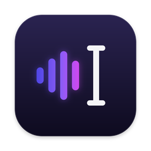
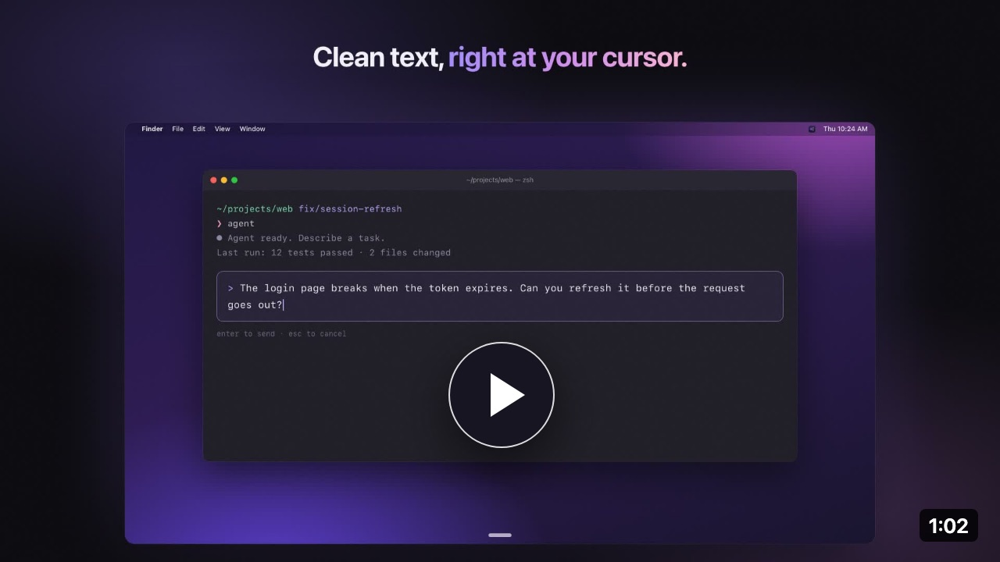

  

<h1 align="center">MioType</h1>

  <b>말하면, 대신 쳐 줘요.</b> 음성 입력과 즉시 번역. 
  <kbd>Fn</kbd>을 누르고 말한 뒤 <kbd>Fn</kbd>을 한 번 더 누르면, 어떤 앱에서든 커서 위치에 글자가 입력됩니다.

  <a href="https://miotype.com/download"><b>macOS용 다운로드</b></a> ·
  <a href="https://miotype.com">웹사이트</a> ·
  <a href="https://miotype.com/pricing">요금</a>

<a href="README.md">English</a> · <a href="README.zh-CN.md">简体中文</a> · <a href="README.de.md">Deutsch</a> · <a href="README.es.md">Español</a> · <a href="README.fr.md">Français</a> · <a href="README.it.md">Italiano</a> · <a href="README.ja.md">日本語</a> · <a href="README.ko.md">한국어</a> · <a href="README.pt.md">Português</a> · <a href="README.ru.md">Русский</a>

   
  <a href="https://www.youtube.com/watch?v=lWkNX-c_a8k">▶ YouTube에서 1분 데모 보기</a>

---

커서가 터미널, VS Code, Cursor, Claude Code나 Codex의 프롬프트, Slack 스레드, 커밋 메시지 중 어디에 있든 상관없습니다. MioType은 포커스가 있는 곳에 입력합니다.

## 단축키

| 키 | 동작 |
|---|---|
| <kbd>Fn</kbd> | 눌러서 말하기 시작, 다시 누르면 입력. <kbd>Esc</kbd>로 취소 |
| <kbd>Fn</kbd> + <kbd>Space</kbd> | 무엇이든 질문하세요. 먼저 텍스트를 선택하면 그 내용에 대해 묻고, "더 짧게 해 줘"라고 말하면 그 자리에서 고쳐 씁니다 |
| <kbd>Fn</kbd> + <kbd>Left Shift</kbd> | 한 언어로 말하면 다른 언어로 입력 |
| <kbd>Fn</kbd> + <kbd>Control</kbd> | 선택한 텍스트를 내 언어나 고른 다른 언어로 번역 |
| <kbd>Fn</kbd> + <kbd>R</kbd> | 선택한 텍스트를 그 자리에서 다듬기 |
| <kbd>Fn</kbd> + <kbd>S</kbd> | 단어나 표현 찾기 |

모든 단축키는 설정에서 바꿀 수 있습니다.

## 개발자가 좋아하는 이유

- **커서가 있는 곳에 바로 입력합니다.** 별도 창도, 복사·붙여넣기도 필요 없습니다. 코딩 에이전트에게 줄 긴 프롬프트, PR 설명, issue 답글을 그 자리에서 말로 쓰세요.
- **언어를 섞어 말해도 그대로.** 영어로 말한 용어와 이름은 문장의 나머지가 어떤 언어든 영어로 남습니다.
- **내 어휘를 배웁니다.** 받아쓰기 직후 잘못 인식된 단어(`kubectl`, `useEffect`, 동료 이름)를 고치면 MioType이 사전에 추가해 다음부터는 맞게 입력합니다. 사전을 가져올 수도 있습니다.
- **오프라인은 스위치 하나로.** 설정에서 로컬 Whisper 모델을 고르면 음성이 Mac 밖으로 나가지 않습니다. 네트워크도 계정도 필요 없습니다.
- **내 API 키 사용.** 인식과 다듬기를 MioType Cloud 대신 원하는 API 제공업체로 보낼 수 있습니다.

## 무료와 유료

| | |
|---|---|
| **로컬** | 평생 무료. Whisper 오프라인 받아쓰기, 내 API 키로 번역과 다듬기. 기록, 사전, 설정은 Mac에 남습니다 |
| **무료 클라우드** | 로그인하면 매주 클라우드 3,000단어 |
| **MioType Cloud** | 매월 클라우드 10만 단어로 클라우드 인식, AI 다듬기와 번역을 API 키 없이. 월 US$9.99, 연 US$59.99 또는 한 번 결제 US$149 |

자세한 내용은 [요금 페이지](https://miotype.com/pricing)에 있습니다. 모든 결제는 14일 이내에 조건 없이 전액 환불됩니다.

## 개인정보

- 로컬 Whisper는 전부 Mac에서 실행됩니다.
- 클라우드 모드에서는 각 요청의 음성이나 텍스트가 저희 서버를 거쳐 Alibaba Cloud Model Studio에서 처리되고, 결과는 바로 돌아옵니다. 저희 서버는 음성과 텍스트를 저장하지 않으며, 사용량 계산을 위해 단어 수, 요청 종류, 시각만 기록합니다.
- 내 API 키를 쓰면 요청이 Mac에서 선택한 제공업체로 바로 전송됩니다.
- 사용자 콘텐츠로 모델을 학습시키지 않으며, 광고나 추적기를 쓰지 않습니다.
- 전체 방침(영어): [miotype.com/privacy](https://miotype.com/privacy)

## 시스템 요구 사항

- Apple 실리콘 Mac(M1 이상)
- 마이크 및 손쉬운 사용 권한. 처음 설정할 때 안내합니다

## 피드백

버그를 찾았거나 원하는 기능이 있나요? [issue를 열어 주세요](https://github.com/miotype/miotype/issues/new/choose). 공개하기 어려운 내용은 [hi@miotype.com](mailto:hi@miotype.com)으로 보내 주세요.

버전별 릴리스 노트는 [Releases](https://github.com/miotype/miotype/releases)에 올라옵니다. **Watch → Custom → Releases**를 누르면 새 버전 알림을 받을 수 있습니다.

---

MioType은 오픈 소스가 아닙니다. 이 저장소는 공개 issue 트래커와 릴리스 노트용입니다.
